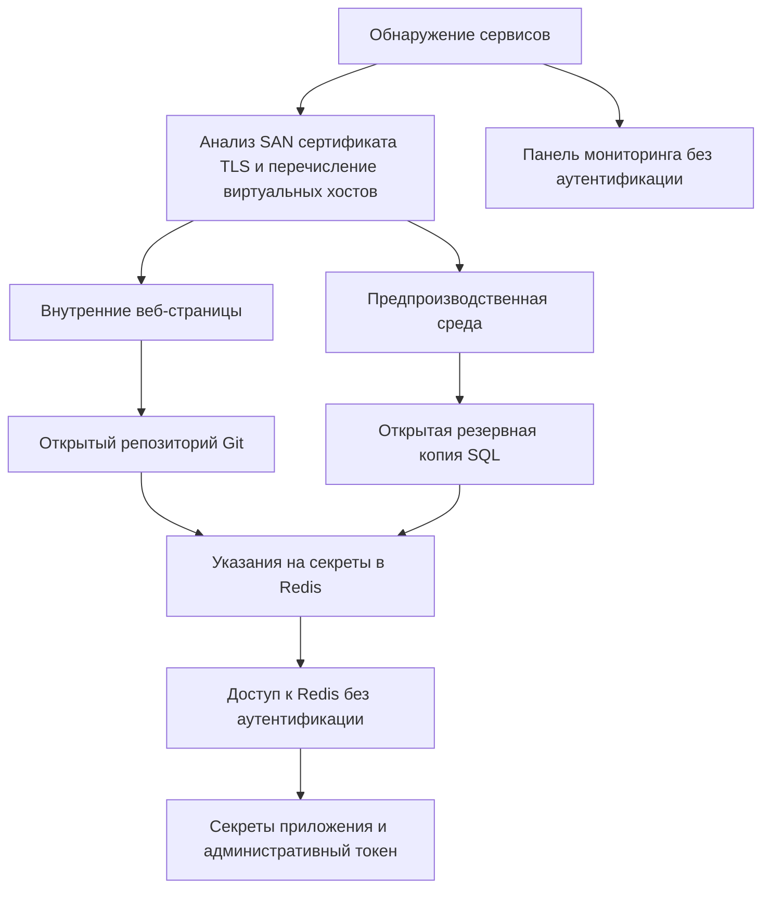

<div align="center">

# MegaCorp · Аудит безопасности

**Внешний аудит методом «черного ящика» в разрешенной учебной среде.**

Разведка, ручная проверка, технические доказательства и приоритетный план устранения.

[Полный отчет](./Informe_auditoria_Sysdig_RU.pdf) · [Выявленные проблемы](#находки) · [Связи между проблемами](#связь-между-выявленными-проблемами)

</div>

---

## Основные сведения

| Общий риск | Задокументированные находки | Снимки экрана с доказательствами | Отчет на русском языке |
| :---: | :---: | :---: | :---: |
| **ВЫСОКИЙ** | **11** | **23** | **56 страниц** |

Этот репозиторий содержит результаты аудита безопасности **учебной среды MegaCorp**. В ходе проверки исследовалось, как публично доступные сервисы, недостаточный контроль доступа и ошибки развертывания могут раскрывать внутренние приложения, резервные копии баз данных, исходный код и секреты приложений.

Для каждой находки в отчете приведены подтверждающие доказательства, шаги воспроизведения, потенциальное воздействие и рекомендуемые меры устранения.

## Отчет

📄 **[Скачать или открыть полный отчет на русском языке](./Informe_auditoria_Sysdig_RU.pdf)**

PDF содержит:

- Резюме для руководства и общую оценку риска.
- Область аудита, правила проведения и ограничения тестирования.
- Карту открытых сервисов и значимых виртуальных хостов.
- Подробное описание находок с командами, снимками экрана и доказательствами.
- Описание цепочки атаки и приоритетный план устранения проблем.
- Приложение с инструментами, словарями и собственным скриптом Bash.

Это русский перевод исходного испанского отчета. Технические идентификаторы, команды и значения доказательств сохранены. При необходимости рядом с оригинальными снимками экрана приведен перевод их текста.

## Область аудита и подход

Проверка охватывала выделенный учебный хост и связанные с ним **сервисы HTTP, HTTPS, FTP и Redis**, включая виртуальные хосты в домене `megacorp.lab`.

Работа включала разведку, перечисление ресурсов, ручную проверку и подготовку отчета. В качестве методологических ориентиров использовались **PTES** и **OWASP Web Security Testing Guide**.

| Этап | Задачи |
| --- | --- |
| **Обнаружение** | Выявить открытые порты, сервисы, версии и сведения из сертификата TLS. |
| **Перечисление ресурсов** | Определить виртуальные хосты, веб-ресурсы, каталоги и доступные репозитории. |
| **Проверка** | Вручную подтвердить открытость ресурсов, отсутствие аутентификации и раскрытие конфиденциальной информации. |
| **Документирование** | Зафиксировать доказательства, объяснить воздействие и предложить практические меры устранения. |

Тестирование проводилось в разрешенной учебной среде. Правила исключали атаки типа «отказ в обслуживании», перебор учетных данных в сервисах аутентификации, изменение или удаление данных целевой системы и переход к ресурсам за пределами установленной области аудита.

## Находки

| ID | Находка | Серьезность |
| --- | --- | :---: |
| **F-01** | Анонимный доступ к сервису FTP | Средняя |
| **F-02** | Раскрытие информации через `robots.txt` | Низкая |
| **F-03** | Раскрытие внутренней информации предпроизводственной среды | Средняя |
| **F-04** | Публично доступная резервная копия базы данных в предпроизводственной среде | Высокая |
| **F-05** | Экземпляр Redis, доступный без аутентификации | Высокая |
| **F-06** | Публично доступный репозиторий Git | Высокая |
| **F-07** | Раскрытие исходного кода и секретов приложения | Высокая |
| **F-08** | Самоподписанный сертификат TLS, раскрывающий внутренние имена хостов | Средняя |
| **F-09** | Внутренний виртуальный хост, доступный через заголовок `Host` | Высокая |
| **F-10** | Открытый репозиторий Git приложения Legacy Billing | Высокая |
| **F-11** | Внутренняя панель мониторинга, доступная без аутентификации | Высокая |

<details>
<summary><strong>Примечание о количестве находок и степени серьезности</strong></summary>

Таблица следует идентификаторам и индивидуальным оценкам серьезности из подробного описания находок. Сводные значения по серьезности в резюме для руководства отличаются от этих подробных записей.

F-06 и F-07 описывают связанные этапы одной цепочки раскрытия информации, а F-10 также относится к репозиторию Git приложения Legacy Billing. Поэтому 11 задокументированных записей включают связанные проблемы и не означают 11 независимых путей атаки.

Перевод отчета сохраняет нумерацию и оценки исходного документа.

</details>

## Связь между выявленными проблемами

Отдельные недостатки конфигурации раскрывали информацию, которая помогала обнаруживать дополнительные ресурсы. Диаграмма показывает связи, подтвержденные доказательствами, и не является строгой хронологией тестирования.



Главный вывод состоит в том, что раскрытие информации и отсутствие контроля доступа могут усиливать друг друга: сертификат раскрывает имена хостов, внутренняя страница указывает на устаревшее приложение, а открытые файлы сообщают, где хранятся конфиденциальные данные.

## Инструменты

| Область применения | Инструменты |
| --- | --- |
| Обнаружение портов и сервисов | Nmap |
| Исследование сертификата TLS | OpenSSL |
| Анализ HTTP и перечисление веб-ресурсов | cURL, ffuf, Gobuster |
| Получение репозитория и анализ исходного кода | Wget, Git |
| Проверка Redis | redis-cli |
| Повторяющиеся запросы к виртуальным хостам | Собственный скрипт Bash |

## Приоритеты устранения

1. **Удалить открытые материалы разработки.** Хранить метаданные Git, дампы баз данных и конфиденциальные файлы конфигурации вне публичных каталогов веб-сервера.
2. **Защитить внутренние сервисы.** Применить аутентификацию, авторизацию, сегментацию сети и соответствующие ограничения межсетевого экрана или VPN.
3. **Заменить раскрытые секреты.** Сменить скомпрометированные учетные данные и токены, исключить повторное использование учетных данных в разных средах.
4. **Усилить защиту веб-серверов и TLS.** Отключить ненужный просмотр содержимого каталогов, проверить содержимое сертификатов и доверие к ним.
5. **Проверять развертывания до публикации.** Проверять публикуемые файлы, выводить устаревшие приложения из эксплуатации и регулярно пересматривать открытость сервисов.

## Проверка целостности PDF

После загрузки отчета и файла [SHA256SUMS](./SHA256SUMS) в одну папку проверьте контрольную сумму.

**Linux:**

```bash
sha256sum --check SHA256SUMS
```

**macOS:**

```bash
shasum -a 256 --check SHA256SUMS
```

Успешная проверка означает, что файл совпадает с опубликованной копией. Контрольная сумма не является цифровой подписью и сама по себе не подтверждает авторство документа.

## Другие языковые версии

[Отчет на арабском литературном языке](https://github.com/nawras2967/CYBERSECURITY-REPORT-IN-ARABIC-) содержит перевод того же исходного испанского отчета. Технические идентификаторы и значения доказательств сохранены в обеих версиях.

## Структура репозитория

```text
.
├── README.md
├── SHA256SUMS
└── Informe_auditoria_Sysdig_RU.pdf
```

---

**Аналитик:** Палома Касабона Агудо (Paloma Casabona Agudo)  
**Дата аудита:** 2 июля 2026 года  
**Версия отчета:** 1.0
